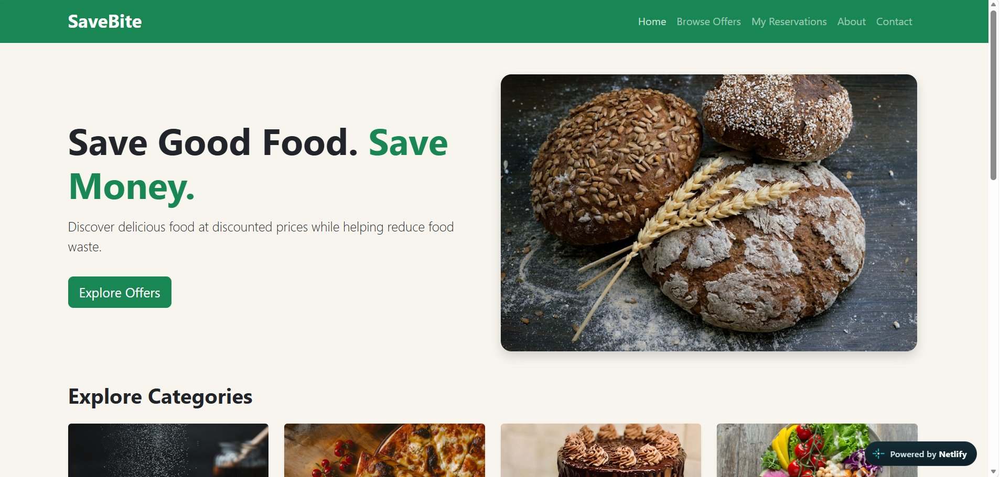
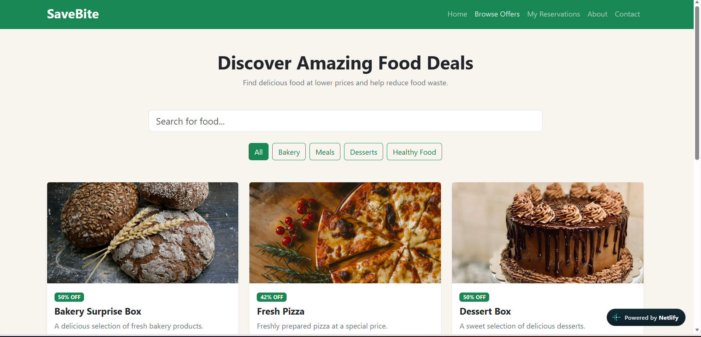
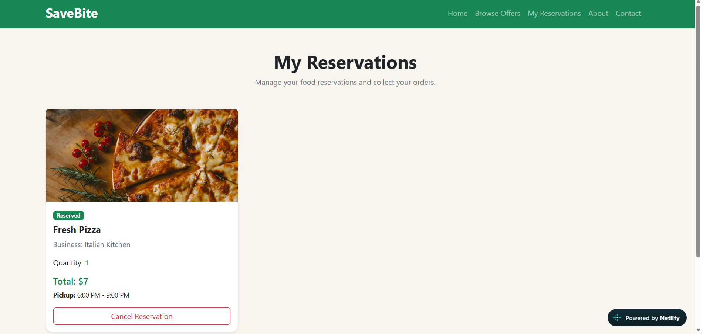
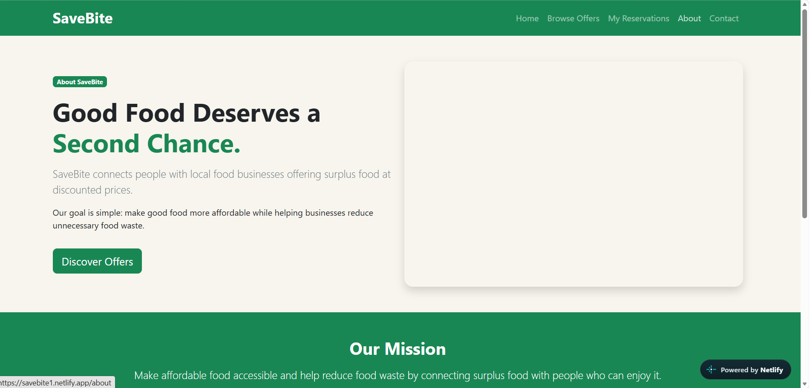
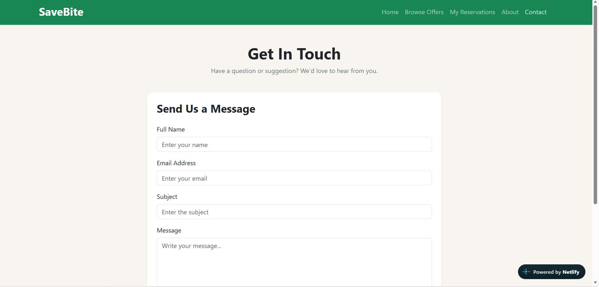

# SaveBite — Food Rescue Marketplace

**Good food. Better prices. Less waste.**

## 1. Project Description

SaveBite is a React-based food rescue marketplace that connects local restaurants, bakeries, and food businesses with customers looking to purchase surplus food at discounted prices.

The platform helps customers save money while helping businesses reduce food waste.

Customers can browse available food offers, view offer details, reserve food quantities, and manage their reservations.

This project was developed as part of the CSCI426 Advanced Web Programming course.

## 2. Main Features

- Home page introducing SaveBite.
- Browse Offers page displaying available discounted food.
- Search and category filtering.
- Dynamic Offer Details pages.
- Food reservation functionality.
- My Reservations page with cancellation functionality.
- About page explaining the platform.
- Contact page with a simulated contact form.
- Responsive layout for different screen sizes.

## 3. Technologies Used

- React.js
- JavaScript
- Bootstrap 5
- React Router DOM
- HTML5
- CSS3
- Vite
- Git and GitHub
- Netlify

## 4. Installation and Setup

### Prerequisites

- Node.js
- npm
- Git

### Installation

1. Clone the repository:

   `git clone https://github.com/52430770-Rash/SaveBite.git`

2. Navigate to the project folder:

   `cd SaveBite/savebite`

3. Install dependencies:

   `npm install`

4. Start the development server:

   `npm run dev`

5. Open the local URL displayed in your terminal.

### Production Build

To create a production build, run:

`npm run build`

The generated production files will be available in the `dist` folder.

## 5. Website Screenshots

### Home Page

### Browse Offers

### My Reservations

### About

### Contact

## 6. Live Deployment

**Website:** https://savebite1.netlify.app/

## 7. GitHub Repository

https://github.com/52430770-Rash/SaveBite

## 8. Project Scope

This phase focuses on the frontend implementation. Food offers use sample data, reservations are managed using React state, and the contact form simulates successful submission.

No backend database, real payment processing, or actual email delivery is implemented in this phase.

## 9. Developer

Developed individually as part of the CSCI426 Advanced Web Programming course.